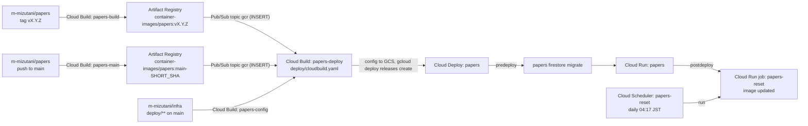

# mztn-papers

Infrastructure of [papers](https://github.com/m-mizutani/papers) on the
`mztn-papers` project. Every release tag of papers and every push to its main
branch (a merged pull request) is built and deployed without any change to the
papers repository.

## Release flow



- **papers-build** (`cloud-build.tf`): a tag `vX.Y.Z` on m-mizutani/papers
  builds the image from source and pushes `papers:vX.Y.Z` to Artifact Registry.
- **papers-main** (`cloud-build.tf`): every push to main of m-mizutani/papers
  (a merged pull request) builds the image the same way and pushes
  `papers:main-<short commit SHA>`.
- **papers-deploy**: Artifact Registry announces the push on the Pub/Sub
  topic `gcr` (the fixed topic name of Artifact Registry notifications). The
  trigger keeps only `INSERT` of a release tag or a main build of the papers
  image and runs
  `deploy/cloudbuild.yaml` from this repository's main branch. It copies
  `deploy/config` to `gs://mztn-papers-config/releases/<release>/` and creates
  a Cloud Deploy release pinned to the image digest. A release that already
  exists is skipped, since Pub/Sub delivers at least once.
- **papers-config**: a change under `deploy/` on main releases the running
  image again with the new configuration.
- **Cloud Deploy** (`cloud-deploy.tf`) runs `papers firestore migrate` as a
  predeploy hook (indexes and TTL policies), then deploys `deploy/service.yaml`.
  The Cloud Run service is owned by Cloud Deploy, not by Terraform.
- **Anonymous mode** (`deploy/service.yaml`, `PAPERS_ANONYMOUS=true`): there
  is no sign-in. A browser without a valid session cookie becomes a new
  anonymous user. The `main` workspace has no `[authz]`, so every user may
  use it.
- **Demo mode** (`deploy/service.yaml`, `PAPERS_DEMO=true`): at startup the
  server fills each workspace that is still empty (no papers but an empty
  home) with sample papers, once. After the daily reset, the samples come back
  only when an instance starts (a deploy or a new instance), because the
  running instance does not seed again.
- **Daily reset** (`scheduler.tf`): Cloud Scheduler runs the Cloud Run job
  `papers-reset` every day at 04:17 JST. The job runs
  `papers firestore reset --force-dangerous-apply`, which deletes **every
  document** in the Firestore database and keeps its indexes and TTL policies.
  Terraform owns the job except its image, which the postdeploy hook switches
  to the deployed image; until the first release it holds a placeholder image
  and its runs fail harmlessly. The job runs as `papers-reset`, which may use
  only the `papers` database (`roles/datastore.user` with an IAM condition),
  and `papers-scheduler` may start only this job (`roles/run.invoker` on the
  job). The server keeps running, so a write during the reset may survive it,
  and the job does not delete objects in the attachments bucket.
- **Attachment cleanup** (`cloud-storage.tf`): after a reset no attachment
  object is referenced any more, so lifecycle rules on the attachments bucket
  delete objects 7 days after they were created (the margin covers days the
  reset fails) and, because the bucket keeps versions, delete noncurrent
  versions 1 day after they became noncurrent.
  Run it by hand with `gcloud run jobs execute papers-reset --region=asia-northeast1`.

Roll back with `gcloud deploy targets rollback papers-prod --delivery-pipeline=papers --region=asia-northeast1`.

## Investigating (read-only)

`papers-reader@mztn-papers.iam.gserviceaccount.com` (`reader.tf`) can read
every resource of the project: the project-wide viewer role of each service
in use, all logs (Data Access audit logs too), metrics, traces and errors. It
cannot read secret payloads. Use it by impersonation
(the principals in `reader_impersonators`):

```bash
gcloud config set auth/impersonate_service_account papers-reader@mztn-papers.iam.gserviceaccount.com
gcloud deploy rollouts list --delivery-pipeline=papers --release=<release> --region=asia-northeast1 --project=mztn-papers
gcloud logging read 'resource.type="cloud_run_revision"' --project=mztn-papers --limit=50
```

`claude@mztn-papers.iam.gserviceaccount.com` (`claude.tf`) is the account
Claude (AI agent) works as, by impersonation (`claude_impersonators`). It reads
what papers-reader reads, and may also publish to the Pub/Sub topic `gcr`
(start papers-deploy by hand), operate releases and rollouts of the papers
pipeline (as papers-deployer), and administer Firestore. It cannot change IAM,
secrets or the other Terraform-managed resources.

## Layout

| Path | Contents |
|---|---|
| `*.tf` | Project resources: APIs, Artifact Registry, Pub/Sub, Firestore Enterprise, buckets, service accounts, Cloud Build triggers, Cloud Deploy, Cloud Scheduler, the read-only papers-reader |
| `deploy/service.yaml` | The Cloud Run service (placeholders `PAPERS_*` are filled by `cloudbuild.yaml`) |
| `deploy/skaffold.yaml` | Render and deploy config, and the custom actions `firestore-setup` (predeploy: `papers firestore migrate`) and `reset-job` (postdeploy: the papers-reset job) |
| `deploy/cloudbuild.yaml` | Creates a release (run by papers-deploy and papers-config) |
| `deploy/config/` | Workspace configuration: `workspaces/*.toml` (+ Rego policies) and `global.toml` |

## Bootstrap (once)

1. Create the state bucket by hand (it is not managed by Terraform) and
   initialize from a local machine (the GitHub Actions service account is
   created by this configuration):

   ```bash
   gcloud storage buckets create gs://mztn-papers-terraform --project=mztn-papers --location=asia-northeast1 --uniform-bucket-level-access
   cd google-cloud/mztn-papers
   terraform init
   ```

   Commit the `.terraform.lock.hcl` that `terraform init` writes.

2. Grant the Cloud Build service agent Secret Manager access (also in
   `iam.tf`; needed before the connection can be created), then create the
   Cloud Build GitHub connection in the console: Cloud Build >
   Repositories (2nd gen) > Create host connection, region `asia-northeast1`,
   name `github`. Install the Cloud Build GitHub App on `m-mizutani/papers`
   and `m-mizutani/infra`.

   ```bash
   gcloud projects add-iam-policy-binding mztn-papers --member="serviceAccount:service-$(gcloud projects describe mztn-papers --format='value(projectNumber)')@gcp-sa-cloudbuild.iam.gserviceaccount.com" --role=roles/secretmanager.admin
   gcloud builds connections create github github --project=mztn-papers --region=asia-northeast1
   ```

3. Apply:

   ```bash
   terraform apply
   ```

4. Commit `.terraform.lock.hcl`. From then on, Terraform is applied only from
   main: pushes to main that change the Terraform files run
   `terraform-apply-mztn-papers.yml` (Workload Identity Federation as
   `github-actions@mztn-papers.iam.gserviceaccount.com`).

5. Push a release tag on m-mizutani/papers or merge to its main (or run the
   papers-build or papers-main trigger by hand) for the first deploy.
