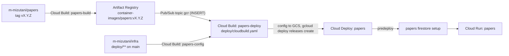

# mztn-papers

Infrastructure of [papers](https://github.com/m-mizutani/papers) on the
`mztn-papers` project. Every release tag of papers is built and deployed
without any change to the papers repository.

## Release flow



- **papers-build** (`cloud-build.tf`): a tag `vX.Y.Z` on m-mizutani/papers
  builds the image from source and pushes `papers:vX.Y.Z` to Artifact Registry.
- **papers-deploy**: Artifact Registry announces the push on the Pub/Sub
  topic `gcr` (the fixed topic name of Artifact Registry notifications). The
  trigger keeps only `INSERT` of a release tag of the papers image and runs
  `deploy/cloudbuild.yaml` from this repository's main branch. It copies
  `deploy/config` to `gs://mztn-papers-config/releases/<release>/` and creates
  a Cloud Deploy release pinned to the image digest. A release that already
  exists is skipped, since Pub/Sub delivers at least once.
- **papers-config**: a change under `deploy/` on main releases the running
  image again with the new configuration.
- **Cloud Deploy** (`cloud-deploy.tf`) runs `papers firestore setup` as a
  predeploy hook (indexes and TTL policies), then deploys `deploy/service.yaml`.
  The Cloud Run service is owned by Cloud Deploy, not by Terraform.

Roll back with `gcloud deploy targets rollback papers-prod --delivery-pipeline=papers --region=asia-northeast1`.

## Layout

| Path | Contents |
|---|---|
| `*.tf` | Project resources: APIs, Artifact Registry, Pub/Sub, Firestore Enterprise, buckets, secrets, service accounts, Cloud Build triggers, Cloud Deploy |
| `deploy/service.yaml` | The Cloud Run service (placeholders `PAPERS_*` are filled by `cloudbuild.yaml`) |
| `deploy/skaffold.yaml` | Render and deploy config, and the `firestore-setup` custom action |
| `deploy/cloudbuild.yaml` | Creates a release (run by papers-deploy and papers-config) |
| `deploy/config/` | Workspace configuration: `workspaces/*.toml` (+ Rego policies) and `global.toml` |

## Bootstrap (once)

1. Create the state bucket and apply once from a local machine (the GitHub
   Actions service account is created by this configuration):

   ```bash
   cd google-cloud/mztn-papers
   gcloud storage buckets create gs://mztn-papers-terraform --project=mztn-papers --location=asia-northeast1 --uniform-bucket-level-access
   terraform init
   terraform import google_storage_bucket.terraform_state mztn-papers-terraform
   ```

   Commit the `.terraform.lock.hcl` that `terraform init` writes.

2. Create the Cloud Build GitHub connection in the console: Cloud Build >
   Repositories (2nd gen) > Create host connection, region `asia-northeast1`,
   name `github`. Install the Cloud Build GitHub App on `m-mizutani/papers`
   and `m-mizutani/infra`.

3. Apply:

   ```bash
   terraform apply
   ```

4. Set the secret values (`PAPERS_ALLOWED_EMAILS` is a comma-separated list):

   ```bash
   echo -n "CLIENT_ID" | gcloud secrets versions add PAPERS_GOOGLE_CLIENT_ID --data-file=- --project=mztn-papers
   echo -n "CLIENT_SECRET" | gcloud secrets versions add PAPERS_GOOGLE_CLIENT_SECRET --data-file=- --project=mztn-papers
   echo -n "you@example.com" | gcloud secrets versions add PAPERS_ALLOWED_EMAILS --data-file=- --project=mztn-papers
   ```

   The OAuth client's redirect URI is `<papers_url output>/api/auth/callback`.

5. Set the repository variable `MZTN_PAPERS_PROJECT_NUMBER` to the
   `project_number` output. From then on, pushes to main that change the
   Terraform files are applied by `terraform-apply-mztn-papers.yml`.

6. Push a release tag on m-mizutani/papers (or run the papers-build trigger
   by hand on an existing tag) for the first deploy.
